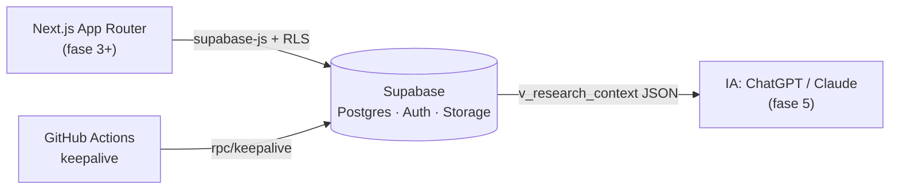

# Arquitectura

## Componentes



- **Supabase es la fuente central.** Guarda los datos estructurados, las fotos y etiquetas (Storage) y los usuarios (Auth). Los cálculos viven en vistas SQL.
- **Next.js (fase 3 en adelante, última versión estable).** App Router, TypeScript y Tailwind. Los formularios son nativos con Server Actions, y Zod valida en el servidor. shadcn/ui y React Hook Form se añaden cuando un componente los necesite (diálogos, combobox), y Recharts en la fase 4. Tipos generados en `src/shared/database/database.types.ts`.
- **IA (fase 5).** Se empieza por lo más simple: exportar el JSON de `v_research_context` y adjuntarlo a la conversación. Después, si hace falta, el servidor MCP oficial de Supabase en modo solo lectura y limitado al proyecto: `https://mcp.supabase.com/mcp?project_ref=<ref>&read_only=true&features=database`.

No hacen falta pgvector ni RAG: los datos son estructurados y SQL los compara con precisión.

## Entornos

| Entorno | Qué es | Cómo se toca |
|---------|--------|--------------|
| Local | Stack de Supabase en Docker (`project_id = research_lab`) | `pnpm supabase:*` (local es el destino por defecto del CLI v3) |
| Hosted | Proyecto propio de Supabase, plan Free | `--remote`, siempre después de un dry-run y con aprobación |
| Producción (app) | Vercel Hobby, proyecto `research-lab-catoverhat`, conectado al repo: cada push a `main` publica `https://research-lab-catoverhat.vercel.app` | Variables de producción: `NEXT_PUBLIC_SUPABASE_URL`, `NEXT_PUBLIC_SUPABASE_PUBLISHABLE_KEY`, `NEXT_PUBLIC_TURNSTILE_SITE_KEY` y `ENABLE_EXPERIMENTAL_COREPACK=1` (para usar el pnpm de `packageManager`). Los previews no tienen variables: no sirven para entrar |

Auth en hosted (aplicado el 2026-11-27): `site_url` y redirecciones al dominio de producción, registro y login anónimo desactivados, y passkeys con RP ID `research-lab-catoverhat.vercel.app`. Cambiar ese dominio invalida las passkeys registradas.

Auth (herramienta personal): solo login, con email y contraseña o con passkey. El registro y el inicio de sesión anónimo están desactivados, y las cuentas se crean desde el dashboard. Las passkeys son las nativas de Supabase Auth (beta, `signInWithPasskey` y `registerPasskey`), sin código WebAuthn propio. Captcha Turnstile (`SUPABASE_AUTH_CAPTCHA_SECRET`). Rotación de refresh tokens activada. Sin confirmación de email.

## Frontend

```
src/
  app/          rutas finas: leen datos y componen secciones
  core/         núcleo común: auth, projects, products (con precios)
  modules/food/ módulo de alimentos: formulations, experiments
  shared/       clientes de Supabase, helpers de formularios, formato y UI base
  proxy.ts      refresca la sesión y redirige a /login
```

- Cada página y cada Server Action llama a `requireUser()`. El proxy no basta como control, y el RLS hace el resto.
- Los datos van por Server Actions con el cliente del usuario, así que nunca se usa la clave secreta. Solo las passkeys usan el cliente del navegador, porque necesitan `navigator.credentials`.
- Un campo vacío se guarda como `null`, nunca como `""` ni `0` (`src/shared/forms.ts`).
- Los precios solo tienen acción de añadir. Una receta con experimentos realizados muestra la composición congelada y ofrece "Crear versión nueva", que copia la receta y sus ingredientes a `version + 1`.

## Módulos

La plataforma no es solo para alimentos. Cualquier investigación para decidir con evidencia (optimizar una receta, elegir qué comprar) usa el mismo **núcleo común**, y cada tipo de investigación añade su **módulo**:

| | Qué incluye | Estado |
|---|---|---|
| Núcleo común | Proyectos, productos, proveedores, historial de precios, fuentes, hipótesis, hallazgos, adjuntos, informes, exportación para IA y notas de excepción | Hecho |
| Alimentos | Nutrición, formulaciones versionadas, experimentos sobre recetas, evaluación sensorial | Hecho (caso: chocolate) |
| Compras | Especificaciones técnicas por producto (atributo, valor, unidad y fuente), experimentos sobre un producto (p. ej. medir el ruido de un abanico) y tipo de proyecto para mostrar solo las pestañas que aplican | Futuro |
| Común a todos, futuro | Matriz de decisión: criterios con peso y dirección ("menos ruido es mejor"), puntuaciones y ranking ponderado. También sirve al chocolate (su índice de calidad propuesto) | Futuro |

- **Una sola plataforma, no un proyecto por tema.** El plan Free admite 2 proyectos activos por organización, y un proyecto aparte duplicaría login, keepalive, frontend e integración con IA.
- **Los módulos futuros se construyen con su primer caso real**, como el chocolate: los datos reales definen el esquema. Todo lo nuevo es aditivo (tablas y columnas nuevas), así que no obliga a rehacer nada.
- **El frontend (fase 3) se organiza por núcleo y módulos.** No debe quedar escrito alrededor del chocolate.

## Decisiones

- **Propiedad por fila, sin roles.** Es una herramienta personal. Si algún día se comparte un proyecto, se añadirían miembros por proyecto y FK compuestas (ver `database-design.md`).
- **Sin backend propio (NestJS).** RLS, vistas y Server Actions bastan.
- **El diseño de los datos está en** [database-design.md](database-design.md).
