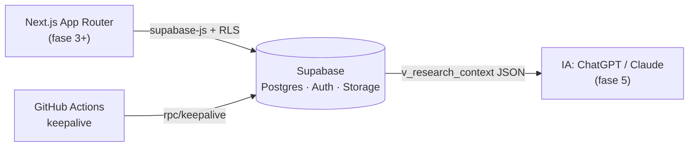

# Arquitectura

## Componentes

- **Supabase es la fuente central.** Guarda los datos estructurados, las fotos y etiquetas (Storage) y los usuarios (Auth). Los cálculos viven en vistas SQL.
- **Next.js (fase 3 en adelante, última versión estable).** Usará el stack de shots-bar: App Router, TypeScript, Tailwind, shadcn/ui, React Hook Form + Zod y Recharts. Tipos generados en `src/shared/database/database.types.ts`.
- **IA (fase 5).** Se empieza por lo más simple: exportar el JSON de `v_research_context` y adjuntarlo a la conversación. Después, si hace falta, el servidor MCP oficial de Supabase en modo solo lectura y limitado al proyecto: `https://mcp.supabase.com/mcp?project_ref=<ref>&read_only=true&features=database`.

No hacen falta pgvector ni RAG: los datos son estructurados y SQL los compara con precisión.

## Entornos

| Entorno | Qué es | Cómo se toca |
|---------|--------|--------------|
| Local | Stack de Supabase en Docker (`project_id = food_research_lab`) | `pnpm supabase:*` (local es el destino por defecto del CLI v3) |
| Hosted | Proyecto propio de Supabase, plan Free | `--remote`, siempre después de un dry-run y con aprobación |

Auth tiene la misma configuración que shots-bar: signup, inicio de sesión anónimo, vinculación manual de cuentas y rotación de refresh tokens activados. Captcha Turnstile (`SUPABASE_AUTH_CAPTCHA_SECRET`). Sin confirmación de email.

## Módulos

La plataforma no es solo para alimentos. Cualquier investigación para decidir con evidencia (optimizar una receta, elegir qué comprar) usa el mismo **núcleo común**, y cada tipo de investigación añade su **módulo**:

| | Qué incluye | Estado |
|---|---|---|
| Núcleo común | Proyectos, productos, proveedores, historial de precios, fuentes, hipótesis, hallazgos, adjuntos, informes, exportación para IA y notas de excepción | Hecho |
| Alimentos | Nutrición, formulaciones versionadas, experimentos sobre recetas, evaluación sensorial | Hecho (caso: chocolate) |
| Compras | Especificaciones técnicas por producto (atributo, valor, unidad y fuente), experimentos sobre un producto (p. ej. medir el ruido de un abanico) y tipo de proyecto para mostrar solo las pestañas que aplican | Futuro |
| Común a todos, futuro | Matriz de decisión: criterios con peso y dirección ("menos ruido es mejor"), puntuaciones y ranking ponderado. También sirve al chocolate (su índice de calidad propuesto) | Futuro |

- **Una sola plataforma, no un proyecto por tema.** El plan Free admite 2 proyectos activos por organización, y un proyecto aparte duplicaría login, keepalive, frontend e integración con IA.
- **Los módulos futuros se construyen con su primer caso real**, como el chocolate: los datos reales definen el esquema. Todo lo nuevo es aditivo (tablas y columnas nuevas), así que no obliga a rehacer nada.
- **El frontend (fase 3) se organiza por núcleo y módulos.** No debe quedar escrito alrededor del chocolate.

## Decisiones

- **Propiedad por fila, sin roles.** Es una herramienta personal. Si algún día se comparte un proyecto, se añadirían miembros por proyecto y FK compuestas (ver `database-design.md`).
- **Sin backend propio (NestJS).** RLS, vistas y Server Actions bastan.
- **El diseño de los datos está en** [database-design.md](database-design.md).
