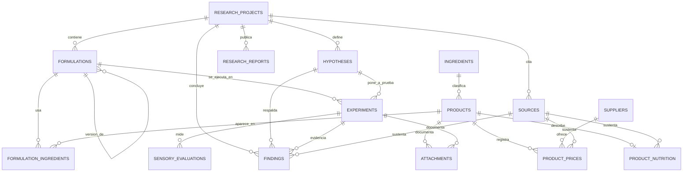

# Diseño de la base de datos

Fuente de verdad: `supabase/migrations/`. Este documento explica el porqué; el SQL manda.

## Diagrama entidad-relación



Todas las tablas tienen además `owner_id → auth.users` (omitido en el diagrama).

## Decisiones

| # | Decisión | Por qué |
|---|----------|---------|
| 1 | Cada fila lleva `owner_id` (por defecto `auth.uid()`), y las políticas comparan solo esa columna. | Políticas simples, sin joins y con índice. Cada usuario, también los anónimos, tiene su propio espacio aislado. |
| 2 | `ingredients` es la materia genérica (cacao). `products` es una presentación comercial concreta (Munné 16 oz ≠ Munné 5 oz). | Los precios y las etiquetas son de una presentación, no de la materia. |
| 3 | `formulation_ingredients.quantity` va en la unidad del producto (`g`, `ml` o `unit`). | Coste y nutrición salen sin tablas de conversión. Las tazas o cucharadas se convierten al registrar. |
| 4 | `product_prices` solo se añade: un precio nuevo es una fila nueva. | Así se conserva el historial. Un experimento se costea con el último precio observado **en o antes** de su fecha, sin guardar copias de precios. |
| 5 | Una formulación es una versión de receta: `(project_id, code, version)`, con `parent_id` apuntando a la versión anterior. | Separa la receta (F05) de sus ejecuciones. Se puede repetir F05 diez veces sin tocarla. |
| 6 | Un trigger congela los ingredientes de una formulación en cuanto tiene un experimento `completed` o `failed`. | Si se editara la receta, se reescribiría en silencio lo que se usó en los experimentos pasados. Para cambiarla se crea `version + 1`. El nombre, las notas y el estado siguen editables. |
| 7 | `sensory_evaluations` guarda una fila por evaluador y atributo, con un score de 0 a 10. El atributo es texto libre. | Sirve para cualquier receta (amargor en chocolate, salinidad en otra) sin cambiar el esquema. Por convención, `overall` es la nota global. |
| 8 | Hay tres ejes de evidencia: `experiments.status` (planificado o realizado), `hypotheses.status` y `findings.evidence_level` (`confirmed`, `preliminary`, `anecdotal`). | Separa lo comprobado, las hipótesis y lo pendiente. |
| 9 | La historia no se borra en cascada: un experimento bloquea el borrado de su formulación, y un ingrediente de receta bloquea el de su producto. Al borrar un usuario se borra todo lo suyo. | Para borrar un proyecto con experimentos hay que borrar antes esos experimentos a propósito. Lo normal es archivarlo (`status = 'archived'`). |
| 10 | Los adjuntos van en el bucket privado `attachments`, bajo la ruta `<uid>/...`. Un `check` obliga a que `attachments.storage_path` empiece por el `owner_id`. | Las políticas de Storage y los metadatos usan la misma regla de carpeta. |
| 11 | Claves naturales únicas: `ingredients(owner, name)`, `suppliers(owner, name)`, `products(owner, brand, name, package_size, unit)`, `formulations(project, code, version)`, `research_reports(project, version)`. | Permiten importar con upsert sin duplicar. |

## Vistas (todas `security_invoker = true`, así respetan el RLS de quien consulta)

| Vista | Resultado |
|-------|-----------|
| `v_price_history` | Cada precio con producto, proveedor y `unit_cost` (precio por g, ml o unidad) |
| `v_product_unit_cost` | Último precio y `unit_cost` por producto |
| `v_formulation_cost` | Coste de un lote y por ración a precios actuales, y `ingredients_without_price` |
| `v_formulation_nutrition` | Nutrición por ración (del lote completo si `servings` es null), y `ingredients_without_nutrition` |
| `v_experiment_summary` | Experimento con su coste a precios de su fecha, número de evaluaciones y `overall_score` |
| `v_sensory_comparison` | Media por formulación y atributo, solo de experimentos `completed` |
| `v_research_context` | Un JSON por proyecto con todo lo necesario para retomar la investigación |

Los contadores `ingredients_without_*` avisan cuando un coste o una nutrición es parcial. Un total parcial nunca se presenta como completo.

## Exportar el contexto de una investigación

```sql
select context from public.v_research_context where project_id = '<uuid>';
```

Por REST, con la sesión del dueño:

```
GET /rest/v1/v_research_context?project_id=eq.<uuid>&select=context
```

El JSON incluye: el proyecto, las hipótesis, los hallazgos, las formulaciones (con ingredientes, coste y nutrición), los experimentos (con coste y evaluaciones), los productos usados (con etiqueta e historial de precios) y las fuentes. No incluye los adjuntos binarios ni los informes. Se puede pegar en una conversación nueva con una IA.

## Seguridad

- Las 15 tablas tienen RLS activado, `revoke all from anon, authenticated`, `grant select, insert, update, delete to authenticated` y cuatro políticas (`select`, `insert`, `update` y `delete`) con `(select auth.uid()) = owner_id`.
- `owner_id` tiene índice en todas las tablas, y cada FK tiene un índice que la encabeza.
- Las vistas solo tienen `grant select to authenticated`. `anon` no ve nada salvo `public.keepalive()`.
- Las funciones son `security invoker` con `search_path = ''`. No hay ninguna `security definer`.
- Los tests están en `supabase/tests/research_core.sql`. Prueban accesos permitidos y denegados (otro usuario, `anon` y Storage), el bloqueo de formulaciones, los cálculos de las vistas y el borrado de un usuario.

## Estrategia de importación de los datos históricos

La conversación de ChatGPT tiene los datos del chocolate (productos, precios, F01–F05…). Se importan en la fase 2 así:

1. ChatGPT entrega JSON estructurado en `research/chocolate/raw-data/`: `products.json`, `prices.json`, `formulations.json`, `experiments.json`, `findings.json` y `sources.json`. Cada registro identifica a los demás por su clave natural (por ejemplo, el producto por `brand + name + package_size + unit` y la formulación por `code + version`), nunca por uuid.
2. Un script de importación (fase 2) lo carga **en una sola transacción**, como el usuario dueño:
   - catálogo (`ingredients`, `suppliers`, `products`, `product_nutrition`) con upsert por clave natural;
   - historia (`product_prices`, `experiments`, `sensory_evaluations`, `findings`) solo como inserción.
3. Si algo falla, no se guarda nada y se puede reintentar. Volver a importar algo que ya entró no está soportado para las filas de historia.
4. No se inventan datos: lo que la conversación no dice queda `null`. Lo observado sin fuente formal se registra en `sources` con `kind = 'observation'`.

## Atajos conocidos

- `shortcut:` las vistas suman importes sin mirar la moneda (por defecto `DOP`). Cuando aparezca una segunda moneda, hay que agrupar por `currency`.
- Las FK no comprueban que la fila referenciada sea del mismo dueño. Un usuario podría referenciar el uuid de otro, pero no leerlo (el RLS lo impide y los uuid no se pueden adivinar). Si algún día hay datos compartidos, se pasaría a FK compuestas `(id, owner_id)`.
- Cada experimento pone a prueba como máximo una hipótesis (`experiments.hypothesis_id`). Si hace falta más, se añadiría una tabla puente.
- `formulations.servings` sigue editable después de congelar la receta. Cambiarlo altera el coste por ración de los experimentos pasados.
- Las formulaciones solo usan `products`. Un ingrediente sin marca, como el agua, se registra como producto sin precio.
